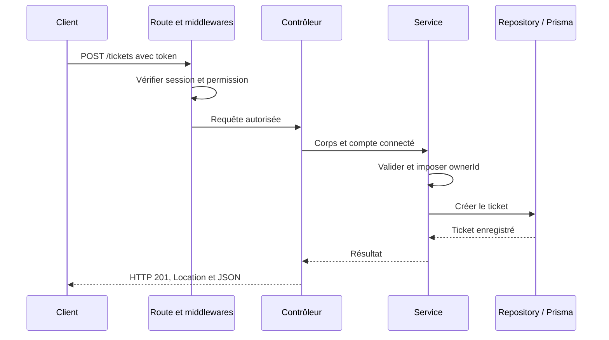

# Architecture du projet

## Lisibilité et mise en forme

Le code suit le modèle de `app.ts` : indentation de deux espaces, imports regroupés, lignes longues découpées et lignes vides entre les étapes ou fonctions. Les variables liées restent regroupées ; les contrôleurs sont séparés visuellement. Les fichiers générés ne sont pas formatés à la main.

Prettier est un outil de développement, pas une dépendance du serveur. Il conserve les lignes vides déjà présentes et harmonise indentation, guillemets et retours à la ligne :

```powershell
npm.cmd run format
npm.cmd run format:check
```

La première commande formate les sources, tests et scripts JavaScript ; la seconde vérifie sans modifier. Garder les séparations logiques en écrivant le code : Prettier ne choisit pas à votre place quelles étapes métier regrouper.

## Pourquoi cette restructuration ?

La version initiale mélangeait dans `app.ts` l'assemblage Express, les routes des tickets, leur validation, les requêtes Prisma et les erreurs. Les autres fichiers de routes mêlaient aussi HTTP et logique métier. Le refactoring sépare ces responsabilités pour faciliter la lecture, les modifications et les tests.

Les URL, corps JSON, permissions, durées des tokens et transactions sont conservés. Il n'y a ni migration ni nouvelle configuration. Une URL inexistante peut désormais renvoyer 404 plus directement, sans passer par les protections d'un ancien routeur générique.

## Organisation

```text
src/
  app.ts                Assemble Express, middlewares et routeurs
  container.ts          Construit et relie les dépendances
  server.ts             Connecte PostgreSQL, démarre et arrête le serveur
  create-admin.ts       Commande locale du premier Super Admin
  config/               JWT et matrice des permissions
  routes/               URL, méthodes HTTP et protections par domaine
  controllers/          Lecture des requêtes et construction des réponses
  services/             Règles métier et orchestration des transactions
  repositories/         Requêtes des tickets et helpers de données des comptes
  middlewares/          Authentification, permissions, limites et erreurs HTTP
  validators/           Validation des champs de tickets
  utils/                Hachage, tokens, validations communes et HttpError
  types/                Typage du compte authentifié dans res.locals
  generated/prisma/     Client généré, à ne pas modifier manuellement
```

Routes et contrôleurs sont regroupés en trois domaines : auth, users et tickets. Les services distinguent connexion, invitations, reset, comptes, tickets et envoi d'emails.

`container.ts` est une simple fonction d'assemblage, pas une bibliothèque d'injection. Elle crée les services une seule fois par application et les transmet aux contrôleurs. Les compteurs et la file email gardent ainsi leur état entre les requêtes. Les tests peuvent injecter une base isolée et un transport email simulé.

## Exemple : créer un ticket



La route ne contient ni requête Prisma ni hachage. Le contrôleur ne décide pas qui possède le ticket : il transmet le compte authentifié au service. Le service reçoit des valeurs simples, sans `req` ni `res`, et retourne un résultat. Le repository connaît Prisma, sans connaître Express.

La validation reste appelée dans les services pour protéger aussi les appels directs sans HTTP. Les permissions de route sont vérifiées par middleware ; les invariants sensibles, comme la propriété d'un ticket ou la consommation d'un code, restent dans les services et les transactions.

## Choix concernant les transactions

Les opérations simples des tickets passent par un repository. Les services de sécurité utilisent directement Prisma injecté pour coordonner plusieurs modèles dans une transaction unique. Cette architecture ne prétend donc pas rendre tous les services indépendants de Prisma.

Un reset doit verrouiller le compte, revalider le code, changer le mot de passe, supprimer les codes et révoquer les sessions de manière atomique. L'orchestration reste dans le service ; les opérations partagées telles que le verrou du compte sont dans `repositories/users.repository.ts`. Aucun accès Prisma n'est effectué dans les routes, contrôleurs ou `app.ts`.

Pour un projet plus important, des repositories transactionnels recevant explicitement `Prisma.TransactionClient` pourraient isoler davantage la persistance. Ici, ajouter un wrapper pour chaque ligne Prisma augmenterait le nombre de fichiers sans bénéfice immédiat. La séparation entre HTTP et métier est déjà réelle et testable.

## Où modifier le code ?

| Besoin | Emplacement |
|---|---|
| Ajouter une URL ou sa protection | routes/ |
| Modifier une réponse HTTP | controllers/ |
| Modifier une règle métier | services/ |
| Modifier une requête de ticket | repositories/tickets.repository.ts |
| Modifier un champ accepté de ticket | validators/tickets.validation.ts |
| Modifier les permissions | config/permissions.ts et route concernée |
| Changer le fournisseur email | services/mail.service.ts |
| Modifier les tables | Schéma Prisma et nouvelle migration |

`app.ts` doit rester un fichier d'assemblage. Une nouvelle fonctionnalité utilise seulement les couches nécessaires à son comportement.

## Validation et redémarrage

```powershell
npm.cmd test
npm.cmd run test:db
```

Les tests HTTP/PostgreSQL existants vérifient les mêmes parcours. Les nouveaux tests du service tickets, sans Express ni PostgreSQL, vérifient le propriétaire imposé, la validation et les filtres de visibilité avec un dépôt simulé.

Les anciens fichiers sources sont supprimés et les imports des tests actualisés. Des fichiers compilés anciens peuvent rester dans dist, mais le serveur n'importe que les nouveaux modules. Le code source de référence est dans src.

Arrêter le serveur avec Ctrl+C, puis :

```powershell
npm.cmd run build
npm.cmd start
```

Les commandes de démonstration des lots précédents restent utilisables. Aucun compte réel n'est modifié par le refactoring. Faire un commit dédié à cette restructuration sur develop.

## Assistance IA (lot 7)

server.ts construit le fournisseur OpenAI optionnel puis le transmet à createApp et container.ts. Le service tickets enregistre le ticket avant de demander son analyse. openai.provider.ts connaît uniquement le transport HTTP et les consignes ; ticket-ai.service.ts garde la logique métier, les transactions et l’audit. La validation des réponses du modèle est séparée dans ai.validation.ts. ticket-access.ts partage le périmètre de visibilité.

L’appel réseau se fait hors transaction ; une version de ticket empêche une réponse tardive de remplacer une décision humaine. Le propriétaire confirme une proposition avant la résolution. Les tests injectent un fournisseur simulé. Les détails et le diagramme du parcours sont dans [LOT7.md](LOT7.md). Contrairement au refactoring initial, ce lot ajoute une migration et une configuration optionnelle.
