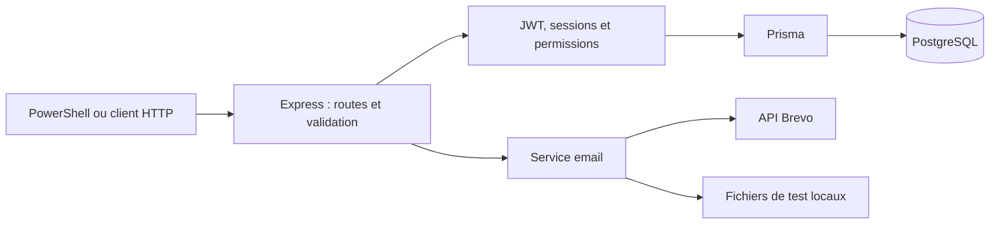

# Lot 5 — Vérification finale et présentation

## Bilan

Les fonctionnalités demandées sont réalisées. Le détail de conformité est dans [CONSIGNES.md](CONSIGNES.md). Ce dernier lot met à jour la documentation et organise la démonstration ; il n'ajoute pas de nouvelle migration ou configuration.

Les parcours d'invitation réelle via Brevo, d'activation, de reset réel, de connexion avec le nouveau mot de passe, de désactivation et de reconnexion après réactivation ont été confirmés manuellement avec l'utilisateur. Le compte de test est revenu à ACTIVE à la fin du parcours.

## Architecture à présenter



Le navigateur n'est pas une interface de l'application : les réponses sont des objets JSON. PowerShell joue le rôle du client et joint les tokens via l'en-tête Authorization.

| Fichier | Ce qu'il faut savoir expliquer |
|---|---|
| src/app.ts | Assemblage des routes et gestion des erreurs |
| src/server.ts | Connexion PostgreSQL, démarrage et arrêt |
| src/security.ts | Validation, scrypt, génération des codes et limites |
| src/jwt.ts | Signature et vérification du JWT |
| src/auth.ts | Login, refresh, logout, middleware et visibilité des tickets |
| src/permissions.ts | Droits des quatre rôles |
| src/invitations.ts | Création, renvoi et activation des comptes |
| src/account-status.ts | Désactivation/réactivation et dernier Super Admin |
| src/password-reset.ts | Demande par email, reset et révocation |
| src/mail.ts | Transport Brevo ou mode local |
| prisma/schema.prisma | Modèles, relations et contraintes |

## Avant la démonstration

1. Vérifier PostgreSQL et la configuration `.env`, sans afficher les secrets au public.
2. Sur une nouvelle connexion réseau, vérifier l'IP autorisée dans Brevo. L'envoi provient de la machine qui exécute l'API.
3. Préparer une adresse de test accessible et un compte Super Admin. Ne pas réutiliser l'adresse d'un compte existant pour une nouvelle invitation.
4. Lancer `npm.cmd run build`, puis `npm.cmd start` dans le premier terminal.
5. Utiliser un second terminal pour les requêtes ; se reconnecter si le JWT a expiré après 15 minutes.

Le mode local permet de présenter les parcours même sans accès à Brevo, mais il faut annoncer clairement qu'il ne livre pas d'email réel. Ne pas supprimer ou réinitialiser la base pour préparer la démonstration.

## Parcours conseillé (10 à 15 minutes)

| Étape | Action | Résultat attendu | Guide |
|---|---|---|---|
| 1 | Connexion Super Admin et GET /auth/me | SUPER_ADMIN, ACTIVE, aucun secret dans la réponse | Lot 2 |
| 2 | Inviter un USER | INVITED et statut d'envoi | Lot 3 |
| 3 | Accepter avec le code reçu | ACTIVE, mot de passe choisi par le destinataire | Lot 3 |
| 4 | Connexion USER, création et lecture d'un ticket | Propriétaire imposé au compte connecté | Lot 2 |
| 5 | Essayer de changer le statut avec USER | 403 | Ci-dessous |
| 6 | Modifier avec Super Admin | 200, nouveau statut | Lot 2 |
| 7 | Renouveler les tokens puis se déconnecter | Nouveau couple, puis session révoquée | Lot 2 |
| 8 | Demander et effectuer un reset | Email, changement, ancienne session refusée | Lot 4 |
| 9 | Désactiver puis réactiver le compte | Accès refusé puis nouvelle connexion nécessaire | Lot 4 |

Les commandes détaillées sont dans les guides précédents. Garder des variables distinctes pour les comptes : `$headersAdmin` pour le Super Admin et `$headersUser` pour l'utilisateur. Ne pas afficher les variables contenant les tokens lors du partage d'écran.

### Montrer le refus d'une action interdite

Avec un ticket créé par le USER et son identifiant dans `$ticket.id` :

```powershell
Invoke-RestMethod -Method Patch -Uri "http://localhost:3000/tickets/$($ticket.id)/status" -Headers $headersUser -ContentType 'application/json' -Body '{"status":"IN_PROGRESS"}'
```

Le 403 est une réussite du contrôle de permission, pas un bug. Rejouer avec `$headersAdmin` doit réussir. Ne pas présenter un 401 de token expiré comme une preuve de contrôle des rôles : le test de rôle nécessite un token valide.

De même, pour démontrer une révocation, vérifier GET /auth/me juste avant l'action puis après avec le même token. Sinon, une expiration préalable pourrait expliquer le refus.

## Expliquer le projet en deux minutes

« Notre API gère des tickets de support et quatre rôles. Le Super Admin invite les comptes, sans inscription publique. Chaque personne choisit son mot de passe grâce à un code reçu par email. Les mots de passe sont hachés avec scrypt. La connexion délivre un JWT court et un refresh token renouvelé à chaque utilisation. Les droits et le propriétaire des tickets sont vérifiés côté serveur. Le reset et la désactivation révoquent les sessions. Les opérations sensibles utilisent des transactions PostgreSQL pour résister aux requêtes simultanées. »

## Questions probables du professeur

**Pourquoi deux tokens ?** L'access token autorise les appels pendant une durée courte ; le refresh permet de renouveler l'accès sans renvoyer le mot de passe. Il est plus durable, donc doit être protégé et révoqué si rejoué.

**Le refresh doit-il aussi être un JWT ?** Dans ce projet, seul l'access token est un JWT. Le refresh est un secret opaque ; l'exigence « JWT access tokens and refresh tokens » est interprétée ainsi. Si le professeur exige explicitement deux JWT, ce point de format devra être ajusté.

**Pourquoi consulter la base avec un JWT ?** Pour vérifier la révocation, l'état du compte et ses droits actuels. Ce projet privilégie la maîtrise des sessions à une vérification entièrement sans état.

**Que se passe-t-il si deux requêtes utilisent le même code ?** Le verrou et la transaction permettent une seule consommation. Pour un refresh rejoué, toute la session est révoquée, y compris le nouveau token éventuellement délivré au premier appel.

**Pourquoi ne pas envoyer un mot de passe temporaire ?** L'administrateur ne doit pas choisir ni connaître le mot de passe du destinataire. L'invitation permet à celui-ci de le définir.

**Pourquoi un message générique pour mot de passe oublié ?** Pour éviter d'indiquer publiquement quelles adresses possèdent un compte. La livraison est traitée après la réponse HTTP.

**Comment créer le premier Super Admin ?** Par un script local protégé contre un double lancement, puis uniquement par invitation authentifiée pour les comptes suivants.

## Validation automatisée

```powershell
npm.cmd test
npm.cmd run test:db
```

La première commande compile et exécute 8 tests sans base ; les 2 scénarios PostgreSQL sont marqués SKIP. La seconde exécute ces 2 scénarios complets, avec plusieurs assertions chacun, sur des schémas temporaires. Ce ne sont donc pas seulement deux petites vérifications. Les emails sont simulés et deux erreurs d'envoi attendues sont journalisées pour vérifier les pannes.

Couverture : refus anonymes, JWT invalides, rôles, propriété des tickets, expiration et rotation, rejeu et concurrence, invitations, panne d'envoi et renvoi, reset, désactivation/réactivation et dernier Super Admin. Les tests ne remplacent pas un audit de sécurité complet.

## Limites à annoncer honnêtement

- Pas d'interface graphique ni de pagination des listes.
- Limites de débit et file email en mémoire ; une interruption brutale peut perdre un envoi planifié.
- L'acceptation par Brevo n'est pas une preuve de livraison ; consulter ses journaux en cas de problème.
- Pas de nettoyage périodique des sessions et codes expirés, ni d'audit détaillé des actions administratives.
- Les calculs scrypt sont bornés par parcours, mais leurs limites s'additionnent ; surveiller les ressources d'un serveur exposé.
- HTTPS, sauvegardes, supervision et file d'envoi durable sont nécessaires avant une utilisation publique sérieuse. Une future interface web devra définir la gestion sûre des tokens/cookies et la protection CSRF.
- Des requêtes déjà autorisées et en cours peuvent terminer après une révocation ; les suivantes sont refusées.

## Dernier commit

```powershell
git status
git add .
git commit -m "docs: finalise la conformite et le guide de presentation"
git push origin develop
```

Vérifier les changements, puis ouvrir une pull request de develop vers main selon les règles du groupe. Aucun merge ou push n'est effectué automatiquement par le guide.
